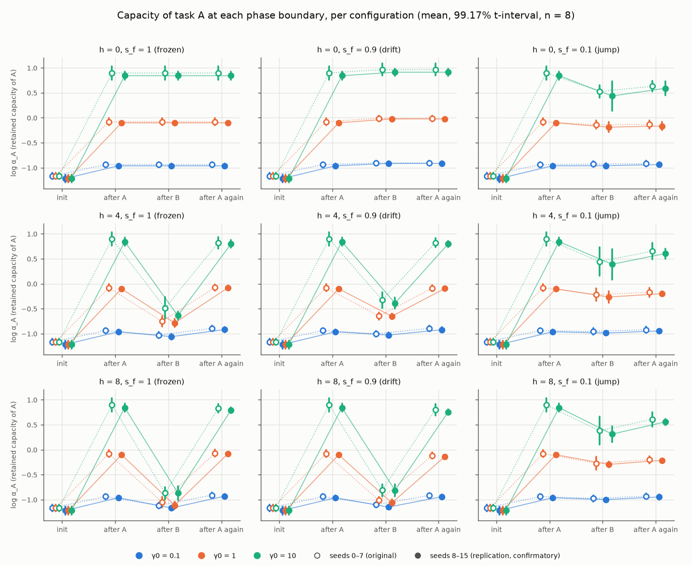
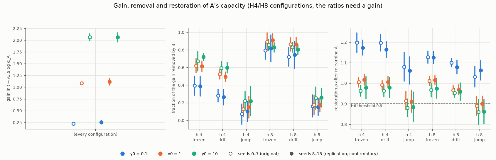
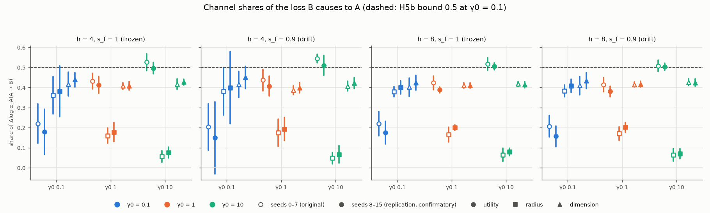
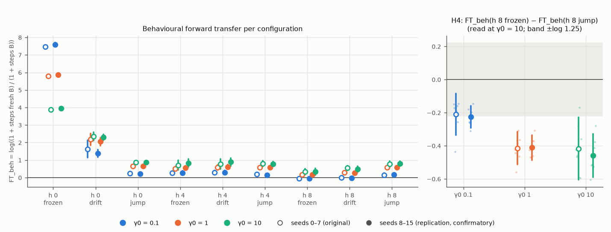
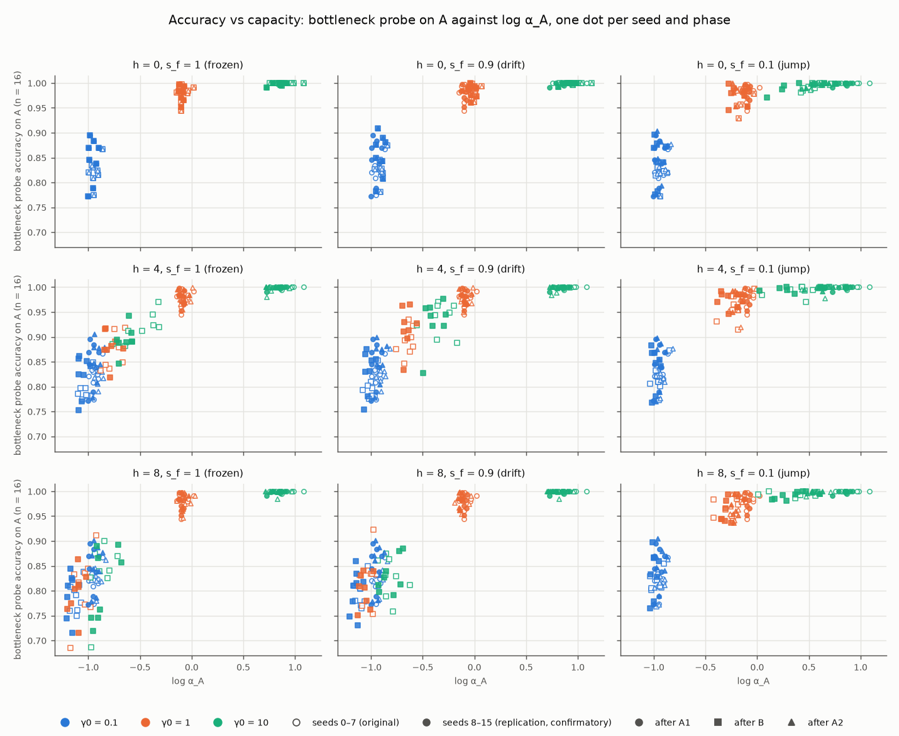

# 30 — A–B–A controlled two-task paradigm: summary of the FULL runs

**Status: 2026-11-09.** Summary of two FULL runs:
- seeds 0–7, the original (grime job 4349);
- seeds 8–15, the replication (job 4396).

The rules are docs/28 as signed (§5 erratum: t = 3.636), and the stratum table in docs/28 §9.3 is
authoritative. Every number here is computed from the two checkpoints by
`notebooks/core/aba_summary.py`. That script also re-derives all 64 statistics of docs/28 §9.3 and
asserts that they match.

**Which run is confirmatory (Kati, 2026-11-09).** The replication, seeds 8–15, is the confirmatory
set. Seeds 0–2 of the original share their `seed_base` draws with the QUICK seeds that shaped the
hypotheses, so the original is reported but is not independent of them. The runs are reported side
by side and never pooled.

**Setting discipline.** Every statement below names its configuration (h, s_f) and its γ0.
- "Held at X" means held at X only. Nothing is summarised across configurations.
- h is Hamming(y_A, y_B) out of P = 16.
- s_f is the input-centre change: 1 is frozen, 0.9 is drift, 0.1 is jump.
- The realised relations and the exposure of every configuration are in its setting card (§4).

## 1. Confirmatory readings (docs/28 §4), by configuration

| hypothesis | configuration it is about | seeds 8–15 (confirmatory) | seeds 0–7 |
|---|---|---|---|
| H1: B removes a larger fraction of A's gain at γ0 10 than at 0.1 | h 4 frozen; h 4 drift | held at h 4 frozen (d = +0.332 [+0.229, +0.436]) and at h 4 drift (+0.333 [+0.233, +0.434]) | held at both |
| H2: the init→A gain rises with γ0 (0.1 → 1 → 10) | before B, so no (h, s_f) | held: +0.861 [+0.828, +0.894]; +0.944 [+0.878, +1.009] | held |
| H3: B with the same labels under drift raises A's capacity | h 0 drift, γ0 0.1 and 10 | **positive in both runs, CI excludes 0, below the pre-set resolution in the replication**: +0.048 [+0.033, +0.062] (1.91 floors) at γ0 0.1, +0.070 [+0.049, +0.090] (1.63 floors) at γ0 10 | held (3.37 and 2.26 floors) |
| H4: specific behavioural forward transfer is negative | h 8 frozen − h 8 jump, γ0 10 | held: −0.459 [−0.591, −0.328] | held |
| H5a: utility + dimension carry ≥ 0.8 of the A→B loss | γ0 10 at h 4 frozen, h 4 drift, h 8 frozen, h 8 drift | held at each of the four | held at each |
| H5b: no channel carries > 0.5 of the A→B loss | γ0 0.1, same four configurations | **not replicated.** Held at h 8 frozen and h 8 drift. Unresolved at h 4 frozen (radius upper bound 0.51) and h 4 drift (radius 0.58, dimension 0.51) | held at each, at the margin (0.4992; docs/28 §5) |
| H6: relearning A restores ≥ 0.9 of the gain | each γ0 at h 4 frozen, h 4 drift, h 8 frozen, h 8 drift (12) | held at each of the 12 | held at each of the 12 |

**What these readings do not say.**
- **H1** is a result at h 4 frozen and h 4 drift only. It was not read at h 8, and there the
  fractions overlap:
  - h 8 frozen: d = +0.013 [−0.153, +0.180] in seeds 8–15 and +0.063 [−0.025, +0.151] in seeds 0–7;
  - h 8 drift: d = +0.061 [−0.090, +0.212] and +0.110 [−0.007, +0.226].

  At h 8 frozen and h 8 drift, B removes 0.74–0.91 of A's gain at every γ0 (seeds 8–15).
- **H6 says nothing about jump.** It was not read there. At h 4 jump and h 8 jump, γ0 1 and 10 sit
  below 0.9 in seeds 8–15:
  - h 8 jump, γ0 10: ρ = +0.862 [+0.803, +0.921];
  - h 4 jump, γ0 10: ρ = +0.885 [+0.814, +0.957].
- **H5b.** The utility-share contrast between γ0 10 and 0.1 is carried to the next
  pre-registration as a test of its own (docs/29 T1). It is not read here.

## 2. Observations (not claims), each in its configuration

- **Lazy relearning overshoots** (γ0 0.1). ρ > 1 at h 4 frozen, h 4 drift, h 8 frozen and h 8 drift,
  in both runs. In seeds 8–15 the values are 1.17, 1.16, 1.13 and 1.08. At γ0 10 in the same four
  configurations, ρ is 0.96–0.98.
- **h 0 drift adds capacity at every γ0.** In seeds 8–15 the A→B change is +0.047, +0.078 and +0.070
  for γ0 0.1, 1 and 10. At h 0 frozen B takes 0 - **The dose comparison (h 8 vs h 4) depends on s_f** (the docs/24 C2 amendment). This is the
  paired per-seed contrast Δlog α_A(A → B) at h 8 minus h 4:

  | s_f | γ0 0.1 | γ0 1 | γ0 10 |
  |---|---|---|---|
  | frozen, seeds 8–15 | −0.108 [−0.133, −0.083] | −0.327 [−0.401, −0.254] | −0.229 [−0.396, −0.062] |
  | frozen, seeds 0–7 | −0.090 [−0.107, −0.073] | −0.295 [−0.383, −0.207] | −0.383 [−0.527, −0.239] |
  | drift, seeds 8–15 | −0.121 [−0.145, −0.097] | −0.413 [−0.463, −0.362] | −0.426 [−0.520, −0.331] |
  | drift, seeds 0–7 | −0.098 [−0.120, −0.077] | −0.368 [−0.432, −0.304] | −0.484 [−0.637, −0.332] |
  | jump, seeds 8–15 | −0.012 [−0.042, +0.018] | −0.029 [−0.159, +0.102] | −0.078 [−0.352, +0.197] |
  | jump, seeds 0–7 | −0.021 [−0.065, +0.024] | −0.053 [−0.213, +0.108] | −0.065 [−0.448, +0.317] |

  - At frozen and at drift, B removes more at h 8 than at h 4 for each γ0, in both runs.
  - At jump the interval includes 0 for each γ0.
  for every γ0 (figure 1).
- **Exposure differs 40–60-fold between γ0 0.1 and γ0 10** (setting cards). For
  example, at h 8 frozen in seeds 8–15, B takes 2137 updates at γ0 0.1 and 36 at γ0 10 (median).
  Every γ0 contrast above is therefore also an exposure contrast. The stopping-rule ablation
  (docs/31) separates the two.
- **Provenance note.** The replication checkpoint also holds one arm at **seed 0** (γ0 0.1, h 8, jump).
  It was run by the notebook's timing-display cell, which still hard-coded seed 0. The readings code
  filters on the run's spec keys, so no reading uses it. It is registered as E18 and fixed in the
  notebook.

## 3. Figures (both runs side by side)

Hollow markers are seeds 0–7 and filled markers are seeds 8–15. Every interval is the 99.17%
t-interval over 8 seeds. Colour codes γ0.

1.  — log α_A at init, after A, after B and after A again. One panel
   per configuration.
2.  — the init→A gain, the fraction of the gain removed by B, and the
   restoration ρ. These are shown at h 4 and h 8 only, where B changes the task.
3.  — the channel shares of the A→B loss in the four H5
   configurations.
4.  — behavioural forward transfer per configuration, and the H4 contrast
   per γ0.
5.  — bottleneck-probe accuracy against log α_A after A, after
   B and after A again, per configuration.

## 4. Setting cards

<!-- BEGIN GENERATED: setting cards -->
Exposure is a property of the setting **as the learner meets it**: training stops at matched loss (≤ 0.05), so each learner sets its own number of updates per phase. The step counts below are that exposure. Realised relations depend on (h, s_f) and the seed only, never on γ0 (checked: identical in all three γ0 arms of a seed).

#### Card: h = 0, s_f = 1.0 (frozen)

Nominal: Hamming(y_A, y_B) = 0 of P = 16; input-centre change s_f = 1.0.

| run | seed | realised s_r(y_A, y_B) | realised ρ_in(A, B) |
|---|---|---|---|
| seeds 0–7 | 0 | +1.000 | 1.0000 |
| seeds 0–7 | 1 | +1.000 | 1.0000 |
| seeds 0–7 | 2 | +1.000 | 1.0000 |
| seeds 0–7 | 3 | +1.000 | 1.0000 |
| seeds 0–7 | 4 | +1.000 | 1.0000 |
| seeds 0–7 | 5 | +1.000 | 1.0000 |
| seeds 0–7 | 6 | +1.000 | 1.0000 |
| seeds 0–7 | 7 | +1.000 | 1.0000 |
| seeds 8–15 | 8 | +1.000 | 1.0000 |
| seeds 8–15 | 9 | +1.000 | 1.0000 |
| seeds 8–15 | 10 | +1.000 | 1.0000 |
| seeds 8–15 | 11 | +1.000 | 1.0000 |
| seeds 8–15 | 12 | +1.000 | 1.0000 |
| seeds 8–15 | 13 | +1.000 | 1.0000 |
| seeds 8–15 | 14 | +1.000 | 1.0000 |
| seeds 8–15 | 15 | +1.000 | 1.0000 |

Exposure: updates per phase, median [min, max] over the run's 8 seeds.

| run | γ0 | A1 | B | A2 | fresh B |
|---|---|---|---|---|---|
| seeds 0–7 | 0.1 | 1787 [1601, 1975] | 0 [0, 0] | 0 [0, 0] | 1787 [1601, 1975] |
| seeds 0–7 | 1 | 328 [304, 359] | 0 [0, 0] | 0 [0, 0] | 328 [304, 359] |
| seeds 0–7 | 10 | 47 [44, 53] | 0 [0, 0] | 0 [0, 0] | 47 [44, 53] |
| seeds 8–15 | 0.1 | 1938 [1761, 2266] | 0 [0, 0] | 0 [0, 0] | 1938 [1761, 2266] |
| seeds 8–15 | 1 | 350 [327, 378] | 0 [0, 0] | 0 [0, 0] | 350 [327, 378] |
| seeds 8–15 | 10 | 51 [47, 54] | 0 [0, 0] | 0 [0, 0] | 51 [47, 54] |

#### Card: h = 0, s_f = 0.9 (drift)

Nominal: Hamming(y_A, y_B) = 0 of P = 16; input-centre change s_f = 0.9.

| run | seed | realised s_r(y_A, y_B) | realised ρ_in(A, B) |
|---|---|---|---|
| seeds 0–7 | 0 | +1.000 | 0.9019 |
| seeds 0–7 | 1 | +1.000 | 0.8980 |
| seeds 0–7 | 2 | +1.000 | 0.8979 |
| seeds 0–7 | 3 | +1.000 | 0.8976 |
| seeds 0–7 | 4 | +1.000 | 0.8958 |
| seeds 0–7 | 5 | +1.000 | 0.9001 |
| seeds 0–7 | 6 | +1.000 | 0.9003 |
| seeds 0–7 | 7 | +1.000 | 0.9000 |
| seeds 8–15 | 8 | +1.000 | 0.8998 |
| seeds 8–15 | 9 | +1.000 | 0.8992 |
| seeds 8–15 | 10 | +1.000 | 0.8987 |
| seeds 8–15 | 11 | +1.000 | 0.8991 |
| seeds 8–15 | 12 | +1.000 | 0.9025 |
| seeds 8–15 | 13 | +1.000 | 0.9007 |
| seeds 8–15 | 14 | +1.000 | 0.8971 |
| seeds 8–15 | 15 | +1.000 | 0.8983 |

Exposure: updates per phase, median [min, max] over the run's 8 seeds.

| run | γ0 | A1 | B | A2 | fresh B |
|---|---|---|---|---|---|
| seeds 0–7 | 0.1 | 1787 [1601, 1975] | 407 [144, 581] | 0 [0, 0] | 1818 [1469, 2067] |
| seeds 0–7 | 1 | 328 [304, 359] | 41 [22, 57] | 0 [0, 0] | 339 [294, 367] |
| seeds 0–7 | 10 | 47 [44, 53] | 4 [2, 6] | 0 [0, 0] | 49 [44, 54] |
| seeds 8–15 | 0.1 | 1938 [1761, 2266] | 484 [410, 705] | 0 [0, 0] | 2110 [1738, 2324] |
| seeds 8–15 | 1 | 350 [327, 378] | 43 [37, 61] | 0 [0, 0] | 363 [316, 380] |
| seeds 8–15 | 10 | 51 [47, 54] | 4 [3, 5] | 0 [0, 0] | 52 [45, 55] |

#### Card: h = 0, s_f = 0.1 (jump)

Nominal: Hamming(y_A, y_B) = 0 of P = 16; input-centre change s_f = 0.1.

| run | seed | realised s_r(y_A, y_B) | realised ρ_in(A, B) |
|---|---|---|---|
| seeds 0–7 | 0 | +1.000 | 0.1015 |
| seeds 0–7 | 1 | +1.000 | 0.1067 |
| seeds 0–7 | 2 | +1.000 | 0.1129 |
| seeds 0–7 | 3 | +1.000 | 0.0828 |
| seeds 0–7 | 4 | +1.000 | 0.0815 |
| seeds 0–7 | 5 | +1.000 | 0.1016 |
| seeds 0–7 | 6 | +1.000 | 0.1124 |
| seeds 0–7 | 7 | +1.000 | 0.0921 |
| seeds 8–15 | 8 | +1.000 | 0.1023 |
| seeds 8–15 | 9 | +1.000 | 0.1101 |
| seeds 8–15 | 10 | +1.000 | 0.0943 |
| seeds 8–15 | 11 | +1.000 | 0.0667 |
| seeds 8–15 | 12 | +1.000 | 0.0877 |
| seeds 8–15 | 13 | +1.000 | 0.0712 |
| seeds 8–15 | 14 | +1.000 | 0.0504 |
| seeds 8–15 | 15 | +1.000 | 0.0704 |

Exposure: updates per phase, median [min, max] over the run's 8 seeds.

| run | γ0 | A1 | B | A2 | fresh B |
|---|---|---|---|---|---|
| seeds 0–7 | 0.1 | 1787 [1601, 1975] | 1427 [1311, 1621] | 169 [0, 282] | 1800 [1707, 2125] |
| seeds 0–7 | 1 | 328 [304, 359] | 172 [154, 187] | 0 [0, 8] | 330 [324, 352] |
| seeds 0–7 | 10 | 47 [44, 53] | 20 [17, 22] | 1 [1, 3] | 49 [47, 50] |
| seeds 8–15 | 0.1 | 1938 [1761, 2266] | 1477 [1294, 1681] | 271 [141, 369] | 1807 [1678, 2087] |
| seeds 8–15 | 1 | 350 [327, 378] | 178 [158, 187] | 8 [0, 19] | 333 [317, 369] |
| seeds 8–15 | 10 | 51 [47, 54] | 20 [18, 23] | 2 [0, 3] | 49 [47, 53] |

#### Card: h = 4, s_f = 1.0 (frozen)

Nominal: Hamming(y_A, y_B) = 4 of P = 16; input-centre change s_f = 1.0.

| run | seed | realised s_r(y_A, y_B) | realised ρ_in(A, B) |
|---|---|---|---|
| seeds 0–7 | 0 | +0.500 | 1.0000 |
| seeds 0–7 | 1 | +0.500 | 1.0000 |
| seeds 0–7 | 2 | +0.500 | 1.0000 |
| seeds 0–7 | 3 | +0.500 | 1.0000 |
| seeds 0–7 | 4 | +0.500 | 1.0000 |
| seeds 0–7 | 5 | +0.500 | 1.0000 |
| seeds 0–7 | 6 | +0.500 | 1.0000 |
| seeds 0–7 | 7 | +0.500 | 1.0000 |
| seeds 8–15 | 8 | +0.500 | 1.0000 |
| seeds 8–15 | 9 | +0.500 | 1.0000 |
| seeds 8–15 | 10 | +0.500 | 1.0000 |
| seeds 8–15 | 11 | +0.500 | 1.0000 |
| seeds 8–15 | 12 | +0.500 | 1.0000 |
| seeds 8–15 | 13 | +0.500 | 1.0000 |
| seeds 8–15 | 14 | +0.500 | 1.0000 |
| seeds 8–15 | 15 | +0.500 | 1.0000 |

Exposure: updates per phase, median [min, max] over the run's 8 seeds.

| run | γ0 | A1 | B | A2 | fresh B |
|---|---|---|---|---|---|
| seeds 0–7 | 0.1 | 1787 [1601, 1975] | 1554 [1204, 1863] | 1006 [837, 1123] | 1903 [1561, 2367] |
| seeds 0–7 | 1 | 328 [304, 359] | 209 [150, 249] | 138 [120, 165] | 350 [297, 384] |
| seeds 0–7 | 10 | 47 [44, 53] | 25 [15, 34] | 15 [14, 23] | 51 [44, 55] |
| seeds 8–15 | 0.1 | 1938 [1761, 2266] | 1493 [1208, 1672] | 982 [900, 1253] | 1902 [1522, 2185] |
| seeds 8–15 | 1 | 350 [327, 378] | 197 [156, 225] | 133 [120, 173] | 344 [307, 364] |
| seeds 8–15 | 10 | 51 [47, 54] | 21 [15, 28] | 14 [13, 23] | 50 [46, 52] |

#### Card: h = 4, s_f = 0.9 (drift)

Nominal: Hamming(y_A, y_B) = 4 of P = 16; input-centre change s_f = 0.9.

| run | seed | realised s_r(y_A, y_B) | realised ρ_in(A, B) |
|---|---|---|---|
| seeds 0–7 | 0 | +0.500 | 0.9019 |
| seeds 0–7 | 1 | +0.500 | 0.8980 |
| seeds 0–7 | 2 | +0.500 | 0.8979 |
| seeds 0–7 | 3 | +0.500 | 0.8976 |
| seeds 0–7 | 4 | +0.500 | 0.8958 |
| seeds 0–7 | 5 | +0.500 | 0.9001 |
| seeds 0–7 | 6 | +0.500 | 0.9003 |
| seeds 0–7 | 7 | +0.500 | 0.9000 |
| seeds 8–15 | 8 | +0.500 | 0.8998 |
| seeds 8–15 | 9 | +0.500 | 0.8992 |
| seeds 8–15 | 10 | +0.500 | 0.8987 |
| seeds 8–15 | 11 | +0.500 | 0.8991 |
| seeds 8–15 | 12 | +0.500 | 0.9025 |
| seeds 8–15 | 13 | +0.500 | 0.9007 |
| seeds 8–15 | 14 | +0.500 | 0.8971 |
| seeds 8–15 | 15 | +0.500 | 0.8983 |

Exposure: updates per phase, median [min, max] over the run's 8 seeds.

| run | γ0 | A1 | B | A2 | fresh B |
|---|---|---|---|---|---|
| seeds 0–7 | 0.1 | 1787 [1601, 1975] | 1444 [1120, 1687] | 834 [730, 1037] | 1918 [1736, 2180] |
| seeds 0–7 | 1 | 328 [304, 359] | 202 [140, 213] | 101 [87, 123] | 351 [321, 372] |
| seeds 0–7 | 10 | 47 [44, 53] | 22 [14, 33] | 10 [8, 11] | 51 [47, 56] |
| seeds 8–15 | 0.1 | 1938 [1761, 2266] | 1410 [1178, 1675] | 826 [759, 1000] | 1816 [1634, 2365] |
| seeds 8–15 | 1 | 350 [327, 378] | 186 [157, 212] | 96 [90, 119] | 339 [306, 385] |
| seeds 8–15 | 10 | 51 [47, 54] | 20 [14, 26] | 10 [8, 11] | 50 [45, 55] |

#### Card: h = 4, s_f = 0.1 (jump)

Nominal: Hamming(y_A, y_B) = 4 of P = 16; input-centre change s_f = 0.1.

| run | seed | realised s_r(y_A, y_B) | realised ρ_in(A, B) |
|---|---|---|---|
| seeds 0–7 | 0 | +0.500 | 0.1015 |
| seeds 0–7 | 1 | +0.500 | 0.1067 |
| seeds 0–7 | 2 | +0.500 | 0.1129 |
| seeds 0–7 | 3 | +0.500 | 0.0828 |
| seeds 0–7 | 4 | +0.500 | 0.0815 |
| seeds 0–7 | 5 | +0.500 | 0.1016 |
| seeds 0–7 | 6 | +0.500 | 0.1124 |
| seeds 0–7 | 7 | +0.500 | 0.0921 |
| seeds 8–15 | 8 | +0.500 | 0.1023 |
| seeds 8–15 | 9 | +0.500 | 0.1101 |
| seeds 8–15 | 10 | +0.500 | 0.0943 |
| seeds 8–15 | 11 | +0.500 | 0.0667 |
| seeds 8–15 | 12 | +0.500 | 0.0877 |
| seeds 8–15 | 13 | +0.500 | 0.0712 |
| seeds 8–15 | 14 | +0.500 | 0.0504 |
| seeds 8–15 | 15 | +0.500 | 0.0704 |

Exposure: updates per phase, median [min, max] over the run's 8 seeds.

| run | γ0 | A1 | B | A2 | fresh B |
|---|---|---|---|---|---|
| seeds 0–7 | 0.1 | 1787 [1601, 1975] | 1547 [1369, 1799] | 363 [142, 611] | 1921 [1571, 2116] |
| seeds 0–7 | 1 | 328 [304, 359] | 186 [161, 207] | 18 [0, 36] | 343 [306, 356] |
| seeds 0–7 | 10 | 47 [44, 53] | 21 [18, 27] | 3 [1, 4] | 50 [46, 52] |
| seeds 8–15 | 0.1 | 1938 [1761, 2266] | 1692 [1346, 1981] | 423 [17, 634] | 1861 [1594, 2222] |
| seeds 8–15 | 1 | 350 [327, 378] | 188 [158, 232] | 18 [0, 44] | 338 [308, 375] |
| seeds 8–15 | 10 | 51 [47, 54] | 22 [18, 29] | 3 [0, 5] | 49 [45, 54] |

#### Card: h = 8, s_f = 1.0 (frozen)

Nominal: Hamming(y_A, y_B) = 8 of P = 16; input-centre change s_f = 1.0.

| run | seed | realised s_r(y_A, y_B) | realised ρ_in(A, B) |
|---|---|---|---|
| seeds 0–7 | 0 | +0.000 | 1.0000 |
| seeds 0–7 | 1 | +0.000 | 1.0000 |
| seeds 0–7 | 2 | +0.000 | 1.0000 |
| seeds 0–7 | 3 | +0.000 | 1.0000 |
| seeds 0–7 | 4 | +0.000 | 1.0000 |
| seeds 0–7 | 5 | +0.000 | 1.0000 |
| seeds 0–7 | 6 | +0.000 | 1.0000 |
| seeds 0–7 | 7 | +0.000 | 1.0000 |
| seeds 8–15 | 8 | +0.000 | 1.0000 |
| seeds 8–15 | 9 | +0.000 | 1.0000 |
| seeds 8–15 | 10 | +0.000 | 1.0000 |
| seeds 8–15 | 11 | +0.000 | 1.0000 |
| seeds 8–15 | 12 | +0.000 | 1.0000 |
| seeds 8–15 | 13 | +0.000 | 1.0000 |
| seeds 8–15 | 14 | +0.000 | 1.0000 |
| seeds 8–15 | 15 | +0.000 | 1.0000 |

Exposure: updates per phase, median [min, max] over the run's 8 seeds.

| run | γ0 | A1 | B | A2 | fresh B |
|---|---|---|---|---|---|
| seeds 0–7 | 0.1 | 1787 [1601, 1975] | 1826 [1505, 2106] | 1501 [1312, 1728] | 1721 [1482, 2066] |
| seeds 0–7 | 1 | 328 [304, 359] | 279 [232, 305] | 224 [197, 254] | 328 [289, 355] |
| seeds 0–7 | 10 | 47 [44, 53] | 34 [24, 44] | 29 [23, 39] | 48 [42, 51] |
| seeds 8–15 | 0.1 | 1938 [1761, 2266] | 2137 [1784, 2373] | 1701 [1466, 1973] | 2006 [1743, 2320] |
| seeds 8–15 | 1 | 350 [327, 378] | 300 [247, 331] | 252 [206, 283] | 353 [318, 390] |
| seeds 8–15 | 10 | 51 [47, 54] | 36 [27, 45] | 34 [24, 46] | 51 [47, 57] |

#### Card: h = 8, s_f = 0.9 (drift)

Nominal: Hamming(y_A, y_B) = 8 of P = 16; input-centre change s_f = 0.9.

| run | seed | realised s_r(y_A, y_B) | realised ρ_in(A, B) |
|---|---|---|---|
| seeds 0–7 | 0 | +0.000 | 0.9019 |
| seeds 0–7 | 1 | +0.000 | 0.8980 |
| seeds 0–7 | 2 | +0.000 | 0.8979 |
| seeds 0–7 | 3 | +0.000 | 0.8976 |
| seeds 0–7 | 4 | +0.000 | 0.8958 |
| seeds 0–7 | 5 | +0.000 | 0.9001 |
| seeds 0–7 | 6 | +0.000 | 0.9003 |
| seeds 0–7 | 7 | +0.000 | 0.9000 |
| seeds 8–15 | 8 | +0.000 | 0.8998 |
| seeds 8–15 | 9 | +0.000 | 0.8992 |
| seeds 8–15 | 10 | +0.000 | 0.8987 |
| seeds 8–15 | 11 | +0.000 | 0.8991 |
| seeds 8–15 | 12 | +0.000 | 0.9025 |
| seeds 8–15 | 13 | +0.000 | 0.9007 |
| seeds 8–15 | 14 | +0.000 | 0.8971 |
| seeds 8–15 | 15 | +0.000 | 0.8983 |

Exposure: updates per phase, median [min, max] over the run's 8 seeds.

| run | γ0 | A1 | B | A2 | fresh B |
|---|---|---|---|---|---|
| seeds 0–7 | 0.1 | 1787 [1601, 1975] | 1725 [1510, 2094] | 1246 [1146, 1458] | 1740 [1477, 2085] |
| seeds 0–7 | 1 | 328 [304, 359] | 247 [215, 278] | 156 [148, 178] | 333 [294, 359] |
| seeds 0–7 | 10 | 47 [44, 53] | 29 [21, 32] | 15 [14, 18] | 49 [43, 52] |
| seeds 8–15 | 0.1 | 1938 [1761, 2266] | 2041 [1775, 2288] | 1383 [1216, 1612] | 2034 [1752, 2298] |
| seeds 8–15 | 1 | 350 [327, 378] | 275 [229, 295] | 167 [149, 192] | 356 [330, 385] |
| seeds 8–15 | 10 | 51 [47, 54] | 30 [24, 40] | 17 [14, 19] | 52 [49, 56] |

#### Card: h = 8, s_f = 0.1 (jump)

Nominal: Hamming(y_A, y_B) = 8 of P = 16; input-centre change s_f = 0.1.

| run | seed | realised s_r(y_A, y_B) | realised ρ_in(A, B) |
|---|---|---|---|
| seeds 0–7 | 0 | +0.000 | 0.1015 |
| seeds 0–7 | 1 | +0.000 | 0.1067 |
| seeds 0–7 | 2 | +0.000 | 0.1129 |
| seeds 0–7 | 3 | +0.000 | 0.0828 |
| seeds 0–7 | 4 | +0.000 | 0.0815 |
| seeds 0–7 | 5 | +0.000 | 0.1016 |
| seeds 0–7 | 6 | +0.000 | 0.1124 |
| seeds 0–7 | 7 | +0.000 | 0.0921 |
| seeds 8–15 | 8 | +0.000 | 0.1023 |
| seeds 8–15 | 9 | +0.000 | 0.1101 |
| seeds 8–15 | 10 | +0.000 | 0.0943 |
| seeds 8–15 | 11 | +0.000 | 0.0667 |
| seeds 8–15 | 12 | +0.000 | 0.0877 |
| seeds 8–15 | 13 | +0.000 | 0.0712 |
| seeds 8–15 | 14 | +0.000 | 0.0504 |
| seeds 8–15 | 15 | +0.000 | 0.0704 |

Exposure: updates per phase, median [min, max] over the run's 8 seeds.

| run | γ0 | A1 | B | A2 | fresh B |
|---|---|---|---|---|---|
| seeds 0–7 | 0.1 | 1787 [1601, 1975] | 1607 [1416, 1923] | 357 [289, 672] | 1882 [1751, 2122] |
| seeds 0–7 | 1 | 328 [304, 359] | 191 [167, 206] | 18 [0, 39] | 335 [323, 348] |
| seeds 0–7 | 10 | 47 [44, 53] | 22 [17, 28] | 2 [0, 5] | 49 [47, 51] |
| seeds 8–15 | 0.1 | 1938 [1761, 2266] | 1536 [1326, 1850] | 452 [240, 716] | 1798 [1626, 2001] |
| seeds 8–15 | 1 | 350 [327, 378] | 181 [163, 229] | 23 [8, 41] | 332 [322, 370] |
| seeds 8–15 | 10 | 51 [47, 54] | 21 [18, 27] | 2 [1, 4] | 49 [47, 54] |

<!-- END GENERATED: setting cards -->
